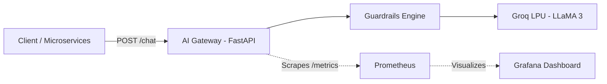

# Production AI Gateway & Observability Suite

> An asynchronous, observable, and secured AI Gateway built with FastAPI, Groq (LLaMA 3), Prometheus, and Grafana.

---

## 📖 Complete Documentation & Interview Guide
For a comprehensive architectural breakdown, top 10 AI Engineer interview questions with model answers, system design scenarios, and production scalability roadmap, see:
👉 **[AI_ENGINEER_GUIDE.md](./AI_ENGINEER_GUIDE.md)**

---

## ⚡ Quick Architecture Overview



## 🚀 Key Features Built
- **FastAPI Asynchronous Gateway**: Validated schemas via Pydantic v2 with non-blocking I/O.
- **Ultra-Fast LLM Inference**: Integrated with Groq's LPU running LLaMA 3.
- **Dual-Phase Guardrails**: Bi-directional defense against prompt injection, jailbreaks, and policy violations.
- **Full-Stack Observability**: Custom Prometheus middleware capturing P50/P95/P99 latency, request rates, token usage, and security events.
- **Automated Monitoring Dashboard**: Pre-provisioned Grafana dashboard (`ai_gateway.json`) deployed via Docker Compose.
- **Security-Hardened Container**: Dockerfile with unprivileged non-root execution (`appuser`).

## 🛠️ Quickstart

```bash
# 1. Launch Prometheus & Grafana
cd AI_gateway
docker-compose up -d

# 2. Configure environment
# Add your GROQ_API_KEY in .env

# 3. Start the FastAPI server
source .venv/bin/activate
uvicorn app.main:app --reload --host 0.0.0.0 --port 8000
```

- **Swagger Docs:** `http://localhost:8000/docs`
- **Grafana UI:** `http://localhost:3000` (User: `admin` / Password: `admin123`)
- **Prometheus UI:** `http://localhost:9090`

